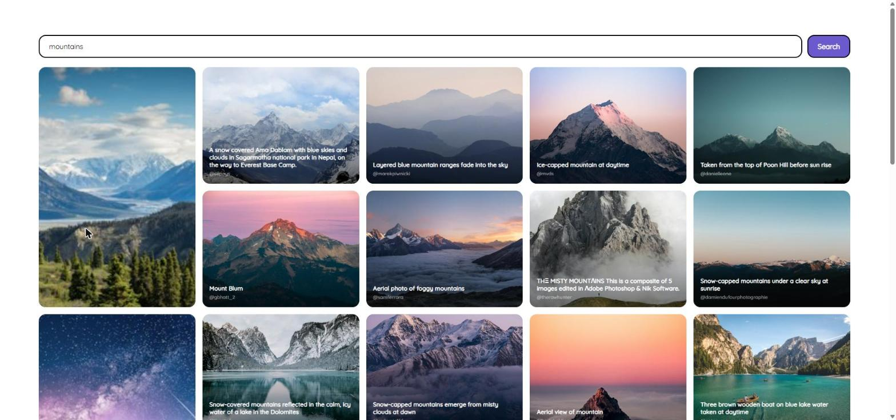

# PHOTO-GALLERY

> Unsplash image viewer app for FrontEnd NUWE Challenge

**[](https://www.codefactor.io/repository/github/wavesforweirdos/photo-gallery)**

**Demo:** https://wavesforweirdos.github.io/photo-gallery/

Gallery built with Vue 3, Vue Router and Vite that browses photos from the [Unsplash API](https://unsplash.com/developers). Click a photo to see its detail.



## Features

- Search Unsplash photos by keyword, with the term kept in the URL so searches can be shared
- "Load more" pagination (30 photos per page)
- Grid with lightweight thumbnails and loading skeletons; cell size depends on the photo's likes
- Photo detail view with description, location and author attribution; close it with `Esc`
- Clear messages for empty results, errors and Unsplash's rate limit (50 requests/hour in demo mode)

## Getting started

```sh
git clone https://github.com/wavesforweirdos/photo-gallery
cd photo-gallery
npm install
cp .env.example .env   # add your Unsplash access key
npm run dev
```

| Script | Description |
|---|---|
| `npm run dev` | Dev server with hot reload |
| `npm run build` | Production build into `dist/` |
| `npm run preview` | Preview the production build |
| `npm run lint` | Lint with [ESLint](https://eslint.org/) |
| `npm test` | Run the [Vitest](https://vitest.dev/) test suite |
